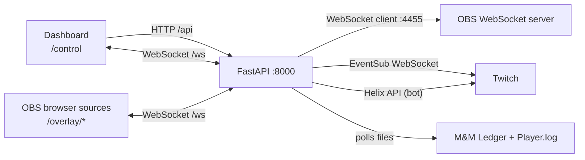

# sang_suite

**A self-hosted streaming toolkit for Twitch and OBS.** A FastAPI backend and a Vue 3 frontend run on
your own machine and give you:

- a **control panel** in your browser for test alerts, OBS scenes and sources, bot chat, clips and a
  panic button
- a set of **transparent overlays** you add to OBS as browser sources: alerts, clips, a death counter
  and a zone banner

Twitch events such as follows, subs, cheers, raids and channel point redeems become on-stream alerts
automatically. Monsters & Memories is read straight from the game's own files, so deaths, level-ups and
zone changes show up on stream as they happen.

Everything runs locally. There's no cloud service, no account to sign up for and no public URL.

---

## Contents

- [Features](#features)
- [How it fits together](#how-it-fits-together)
- [Requirements](#requirements)
- [Quick start](#quick-start)
- [Configuration](#configuration)
- [Adding the overlays to OBS](#adding-the-overlays-to-obs)
- [The control panel](#the-control-panel)
- [Alert settings and channel point rewards](#alert-settings-and-channel-point-rewards)
- [Clips and gifs](#clips-and-gifs)
- [Monsters & Memories integration](#monsters--memories-integration)
- [API reference](#api-reference)
- [WebSocket protocol](#websocket-protocol)
- [Security model](#security-model)
- [Project structure](#project-structure)
- [Development](#development)
- [Troubleshooting](#troubleshooting)
- [Roadmap](#roadmap)

---

## Features

### On stream

| Overlay | What it does |
|---|---|
| **Alerts** | Follow, sub, resub, cheer, raid, redeem and level-up alerts. Each kind has its own headline, accent colour and synthesised jingle. Back-to-back alerts queue instead of overwriting each other. |
| **Media** | Plays clips and gifs triggered by channel point redeems. Redeems queue in order, or a clip can be set to cut in. |
| **Death counter** | A corner widget counting this stream's Monsters & Memories deaths. It has an Underdark-grimoire look: a spider sigil in a ring of runes, a candle-lit blackletter count, and a bell on every death. |
| **Zone banner** | A lower-third that names each M&M zone as you enter it, with an optional line of lore you write yourself. |

### Behind the scenes

- **Twitch EventSub.** Follows, new subs, resubs, cheers, raids and channel point redeems fire alerts
  with no polling and no third-party alert service.
- **Chat bot.** Posts to chat as its own Twitch account, behind a rate limiter that keeps it from
  getting timed out.
- **OBS control.** Switch scenes and tick sources on and off from the dashboard. The lists come from
  OBS itself, so you choose from what actually exists.
- **Reward routing.** Each channel point reward can trigger an alert, a clip, or both. Rewards are
  matched by their stable reward id, so renaming one on Twitch changes nothing here.
- **Ledger history.** Every M&M Ledger event (loot, coin, harvests, trades, level-ups, party members) is
  stored in SQLite and can be queried. That's the raw material for stream recaps.
- **Reliable delivery.** Every event carries a sequence id. An overlay that drops its connection and
  reconnects is sent what it missed, so an alert landing during a network blip isn't lost.
- **Live settings.** Alert labels, colours, sounds, duration and volume are edited in the dashboard and
  reach OBS immediately, with no browser-source refresh.
- **Panic button.** One click clears every queue and blanks every overlay.
- **Self-healing.** Overlays reconnect on their own after a backend restart. On startup the backend
  also refreshes any OBS browser source that got stuck on an error page.
- **Graceful degradation.** OBS closed, Twitch not configured, M&M not installed: each one just
  disables its own feature. Nothing stops the backend from booting.

---

## How it fits together



The backend is a hub. Everything that happens comes in from Twitch, from the dashboard or from the game
files, gets turned into a small JSON message, and is broadcast over `/ws` to every open page. Each
overlay picks out the message types it cares about and ignores the rest.

There are **several WebSockets, pointing in different directions.** This is the thing most worth
understanding up front:

| | Who dials whom | Purpose |
|---|---|---|
| `/ws` | browsers dial **in** to the backend | the event relay to the overlays and the dashboard |
| `OBSController` | backend dials **out** to OBS on `:4455` | switching scenes, showing and hiding sources |
| EventSub | backend dials **out** to Twitch | receiving follows, subs, redeems and so on |

The overlays are **separate pages on purpose.** If they shared one page, a clip and a follow alert would
fight over a single DOM and a single audio context. As separate browser sources they layer and compose
independently in OBS.

---

## Requirements

- **Python** 3.12+ (developed on 3.14)
- **Node** `^22.18` or `>=24.12`
- **OBS Studio** 28+ (the WebSocket server is built in from 28 onward)
- *Optional:* a Twitch application, for automatic alerts and the chat bot
- *Optional:* Monsters & Memories, for the death counter, zone banner and level-up alerts

---

## Quick start

```sh
git clone https://github.com/Sanguine-Hexcraft/sang_suite.git
cd sang_suite

# backend
cd backend
python3 -m venv venv
source venv/bin/activate
pip install -r requirements.txt
cp .env.example .env          # then fill it in -- see Configuration
cd ..

# frontend
cd frontend
npm install
cd ..
```

Then pick a mode.

### Streaming: one process

```sh
./stream.sh                # build the frontend, then serve everything on :8000
./stream.sh --skip-build   # reuse the last build when the frontend hasn't changed
```

Open **<http://localhost:8000/control>**, and point OBS at `http://localhost:8000/overlay/...`.

`stream.sh` rebuilds by default because a stale build fails silently. The backend happily serves
whatever is in `frontend/dist/`, so without a rebuild an overlay looks as if your code changes never
landed.

### Developing: two processes

```sh
# terminal 1 -- backend on :8000, auto-reloads on save
cd backend && source venv/bin/activate && fastapi dev main.py
```

```sh
# terminal 2 -- Vite on :5173, hot module reload
cd frontend && npm run dev
```

Open **<http://localhost:5173/control>**. The browser only talks to Vite, which proxies `/api`, `/ws`
and `/media` through to the backend.

> The two modes can't run at the same time, because both want port 8000.

---

## Configuration

All machine wiring and secrets live in `backend/.env`. It's gitignored; copy it from
`backend/.env.example`. Every section is optional: leave one blank and that feature is simply off.

### OBS

1. In OBS, open **Tools → WebSocket Server Settings**. Enable the server, leave the port at `4455`, and
   copy the password.
2. Add it to `backend/.env`:

   ```ini
   OBS_WS_URL=ws://localhost:4455
   OBS_WS_PASSWORD=your-password-here
   ```

The connection is lazy. The backend starts fine without OBS running, and an error only appears when you
press a control button.

### Twitch alerts

1. Register an application at <https://dev.twitch.tv/console/apps>, with the OAuth redirect URL
   `http://localhost:17563`.
2. Add its credentials and your channel name to `backend/.env`:

   ```ini
   TWITCH_CLIENT_ID=...
   TWITCH_CLIENT_SECRET=...
   TWITCH_CHANNEL=your_channel_login
   ```

3. Make sure `TWITCH_EVENTSUB_WS` and `TWITCH_EVENTSUB_API` are **blank or commented out**. They exist
   only to point at the Twitch CLI mock server during testing.
4. Start the backend. A browser tab opens for a one-time **Authorize** click. **Authorize as the
   broadcaster** (the channel owner), not the bot. Authorizing as anyone else leaves every subscription
   rejected.

The token is cached in `backend/.twitch_tokens.json` (gitignored, and as sensitive as a password), so
later restarts are silent.

### Chat bot

The bot is a **second Twitch account** that authorizes the same application. It needs no extra `.env`
values.

1. Start the backend after the Twitch step above. A second browser tab opens.
2. On Twitch's consent page, click **"Not you?"** and log in as the bot account. Your browser is
   normally logged in as the broadcaster.
3. The bot's token is cached separately, in `backend/.chat_tokens.json`.

If it got authorized as the wrong account, the startup log warns you. Delete `.chat_tokens.json` and
restart to authorize again.

### Monsters & Memories

Nothing to set in most cases. The game's settings folder is auto-discovered from the umu Wine prefixes
under `~/.local/share/mnm/`. If your install lives elsewhere (Steam compatdata, a custom prefix),
point at the folder that holds `settings.json`:

```ini
MNM_SETTINGS_DIR=/path/to/Niche Worlds Cult/Monsters and Memories
```

---

## Adding the overlays to OBS

Add each one as **Sources → Add → Browser Source**.

| Overlay | URL | Size | Notes |
|---|---|---|---|
| Alerts | `http://localhost:8000/overlay/alert` | 1920 × 1080 | full canvas |
| Media | `http://localhost:8000/overlay/media` | 1920 × 1080 | tick **Control audio via OBS** |
| Death counter | `http://localhost:8000/overlay/deaths` | ~420 × 180 | position it in a corner |
| Zone banner | `http://localhost:8000/overlay/zone` | 1920 × 300 | pin it to the bottom edge |
| Spotify now playing | `http://localhost:8000/overlay/spotify` | ~470 × 200 | display only; the sound is the Spotify app's |

In development, use port `5173` instead of `8000`.

On every source, tick **Shutdown source when not visible** and **Refresh browser when scene becomes
active**. OBS caches page assets aggressively, and these settings save you from clearing the cache by
hand after an overlay changes. Tick **Control audio via OBS** on any source whose sound you want in your
mix (media, alerts, the death bell).

**[`learning/overlays.md`](learning/overlays.md) is the full guide.** It covers every overlay, what fires
it, how to set it up and tune it in OBS, and what to check when one stays blank.

---

## The control panel

`/control` has two tabs.

**Live** holds the cards you use while streaming:

| Card | What it does |
|---|---|
| **Panic** | Clears every queue and blanks every overlay. |
| **Test Alerts** | Fires an alert of any configured kind with custom text, to check what each one looks and sounds like. |
| **Bot Chat** | Posts a message as the bot. *Burst ×30* checks the rate limiter. |
| **OBS Control** | A scene dropdown with *Switch Scene*, plus a checkbox per source in that scene: ticked means visible. The ⟳ button re-reads OBS, since changes made in OBS itself aren't pushed to the page. |
| **Death Counter** | The live count. *New Stream* starts a fresh count, ±1 corrects it, and *Test* previews the flare and bell without changing the count. |
| **Monsters & Memories** | Shows whether the backend is actually reading the game: current zone, last banner, last Ledger event. Includes zone and level-up test buttons. |
| **Test Clips** | Plays any file in `backend/media/` on the media overlay, queued or as an interrupt. Lets you check a clip's codec, volume and framing in OBS before a reward points at it. |
| **Activity** | The last 50 events, newest first. It survives page refreshes and backend restarts. |

**Alert Settings** is where you edit the alerts themselves (see below). Unsaved edits survive switching
back and forth between tabs.

Status pills in the header show whether the API, the WebSocket and OBS are up.

---

## Alert settings and channel point rewards

Widget settings live in `backend/config.json`. The file is gitignored and optional: defaults live in the
Pydantic models in `main.py`, so a fresh clone runs without it, and the file is only written the first
time you click **Save Settings**. A malformed file logs a warning and falls back to the defaults instead
of stopping the server.

From the **Alert Settings** tab you can change:

- **Duration** of each alert on screen (0.5–60 s)
- **Volume** of the jingles
- the **label**, **accent colour** and **sound** for each alert kind, with a ▶ preview button

Saving writes the file *and* broadcasts the new config over `/ws`, so the change lands in OBS
immediately.

> **Adding a new alert kind takes two edits, not one:** `DEFAULT_KINDS` in `main.py` *and* `config.json`.
> The file replaces `kinds` wholesale at load, so a kind added only to the defaults never reaches a
> machine that already has a config file.

### Channel point rewards

`config.json` also has a `rewards` section, mapping each **reward id** to what should happen when it's
redeemed:

```json
"rewards": {
  "59640e4f-7e7a-4f8f-968d-23b4958bee88": {
    "label": null,
    "actions": ["alert", "media"],
    "media": "videos/bait.webm",
    "interrupt": false
  }
}
```

- **Keyed by id, never by title.** Titles get renamed on a whim; ids are stable.
- **`label: null`** uses the reward's own Twitch title, so renaming the reward updates the alert for
  free.
- **`actions`** can contain `alert`, `media`, or both.
- **`interrupt`** decides whether a clip cuts in or waits its turn.

Redeeming a reward that isn't listed logs a copy-pasteable line instead of alerting. That's how you
discover reward ids:

```
[redeem] unconfigured reward 'Play a clip' id=9c8b7a6d-… cost=5000 -- add it to config.json
```

---

## Clips and gifs

Media lives in `backend/media/` (gitignored) and is served at `/media`. Drop a file in, reference it from
a reward's `media` path, and you're done: no rebuild, and no video in git.

**Encode clips as WebM (VP9 + Opus).** OBS's bundled browser on Linux frequently ships without
proprietary codecs. An H.264/AAC MP4 can then play silently, or not at all, *while working perfectly in
your normal browser*.

```sh
ffmpeg -i clip.mp4 -c:v libvpx-vp9 -crf 32 -b:v 0 -row-mt 1 \
       -c:a libopus -b:a 128k clip.webm
```

Gifs and webp files play as images. They loop forever and never fire an `ended` event, so they're shown
on a fixed timer instead of being chained on playback.

---

## Monsters & Memories integration

Three watchers read the game's files on a short poll. None of them touches the game itself.

- **Death counter** (`backend/mnm.py`) reads the per-character **Ledger**, the game's JSON event
  journal. `deaths.json` stores only when the stream started plus any manual correction, never the count
  itself. The count is recomputed from Ledger timestamps, so a restart can't lose or double it. A session
  older than 6 hours at startup counts as yesterday's, so the count starts over.
- **Ledger ingester** (`backend/ledger.py`) copies *every* Ledger event into `backend/ledger.db`
  (SQLite), broadcasts your own level-ups as alerts, and serves the stats endpoints. Re-ingesting is
  always safe: rows are keyed by a hash of the event. If you delete the database, it rebuilds from
  whatever the game still has on disk.
- **Zone banner** (`backend/zones.py`) tails `Player.log` and announces a zone once the loading screen
  clears, not when loading starts. Display names and lore come from `backend/zones.json`, which is
  committed, editable, and re-read on every zone change.

On startup each watcher quietly catches up on what's already on disk, so a backend restart mid-stream
never replays old deaths, level-ups or zones.

---

## API reference

All routes are under `/api`. Responses are JSON.

| Method | Endpoint | Body | Description |
|---|---|---|---|
| `GET` | `/api/health` | | Health check: `{"status": "ok"}` |
| `GET` | `/api/activity` | | The last 20 events, oldest first; survives restarts |
| `POST` | `/api/panic` | | Clear every queue and blank every overlay |
| `POST` | `/api/chat` | `{"text": "..."}` | Post to chat as the bot (1–500 chars) |
| `GET` | `/api/config` | | Current widget settings |
| `PUT` | `/api/config` | full config object | Replace settings, save them to disk, push them to the overlays |
| `GET` | `/api/media` | | Every file in `backend/media/`, as reward-ready paths |
| `GET` | `/api/obs/scenes` | | Every scene, plus which one is live |
| `GET` | `/api/obs/sources?scene=` | | The sources in one scene, with visibility |
| `POST` | `/api/obs/scene` | `{"scene": "..."}` | Switch the live scene |
| `POST` | `/api/obs/source` | `{"scene": "...", "source": "...", "visible": true}` | Show or hide a source |
| `GET` | `/api/deaths` | | This stream's death count, session start and last death |
| `POST` | `/api/deaths/reset` | | New stream: count from now |
| `POST` | `/api/deaths/adjust` | `{"delta": -1}` | Manual correction (±10 per call) |
| `GET` | `/api/ledger/summary?since=&owner=` | | M&M stats since `since` (default: the last New Stream) |
| `GET` | `/api/ledger/recent?kind=&limit=` | | The latest Ledger events, optionally of one kind (`limit` 1–500) |
| `GET` | `/api/zone` | | The zone you're in, with its display name and lore |

The error codes worth knowing:

| Code | Meaning |
|---|---|
| `503` | The backend can't reach the service: OBS isn't running or its WebSocket server is off, or the bot isn't connected. |
| `502` | The service was reached but refused: usually a misspelled scene or source name, or Twitch rejecting a chat message. |
| `429` | The bot's own rate limiter refused the message (20 per 30 s). |

---

## WebSocket protocol

`/ws` is a broadcast relay: every message goes to every connected page.

**Alerts**, from Twitch, from the dashboard, or from M&M level-ups:

```json
{ "type": "alert", "kind": "follow", "user": "Innoruuk", "amount": null, "text": "New Follower: Innoruuk" }
```

`kind` selects the label, colour and sound from the config. Manual alerts without a `kind` use
`generic`.

**Media**, read only by `/overlay/media`:

```json
{ "type": "media", "src": "/media/videos/bait.webm", "title": "...", "user": "...", "interrupt": false }
```

**Deaths**, from the backend:

```json
{ "type": "death", "count": 7, "character": "...", "zone": "Blindmidden", "text": "... died in Blindmidden" }
```

`count` is the absolute total for the stream, so a replayed message can't make the overlay drift. A reset
or manual correction is pushed as `{"type": "deaths", ...state}`.

**Zone changes**, read only by `/overlay/zone`:

```json
{ "type": "zone", "zone": "nightharbore", "name": "Night Harbor East", "lore": "...", "text": "Entered Night Harbor East" }
```

**Server-only messages:** `config` (settings changed), `panic`, `deaths` (counter state) and `ledger`
(feed-only Ledger events). A client can only *send* `alert`, `death`, `zone` and `media`. Anything else
is dropped, and a `media` message whose `src` isn't under `/media/` is refused.

### Delivery guarantees

Every broadcast except `config`, `panic`, `deaths` and test previews is stamped with a monotonic `id` and
an `at` timestamp, and kept in a 50-message history. When a client connects, it sends
`{"type": "hello", "last_id": N}` and receives only what it missed, flagged `replay: true`. The endpoint
handles `hello` itself and never relays it.

The client keeps its watermark in module scope, deliberately not in `localStorage`. It survives the
reconnect loop (a backend restart, a network blip) but not a page reload. That way, a browser source
opening fresh mid-stream starts clean instead of dumping an hour of backlog onto your canvas.

The last 20 events are also saved to `backend/activity.json`, *together with the sequence counter*. If
the counter reset to 1 after a reboot, an overlay still holding a higher `last_id` would treat every new
event as already seen and get no replay at all.

---

## Security model

**Nothing has a login, so the backend is local-only by design.** Anyone who can reach it can post as the
bot, switch your scenes and put any clip on stream. These guards keep it that way:

- **Loopback only.** `stream.sh` binds `127.0.0.1`, so other machines on your network can't connect.
- **DNS rebinding.** `TrustedHostMiddleware` refuses any `Host` other than `localhost` or `127.0.0.1`.
- **Cross-site requests.** A web page you visit could otherwise POST to `localhost:8000` or open `/ws`
  (WebSockets ignore CORS). A non-local `Origin` header is refused on every non-GET request and on the
  WebSocket handshake. Requests with no `Origin` at all, like curl, aren't from a web page and are
  allowed.
- **Relay allow-list.** Clients can only relay `alert`, `death`, `zone` and `media` messages. The
  messages only the server sends can't be forged, and media must come from the backend's own `/media`
  mount. The media overlay checks that again before playing anything.
- **No HTML injection.** Viewer-supplied text, like redeem input and display names, is always rendered
  as text and never as HTML.
- **Secrets stay out of git.** `.env`, both token caches, the config and all runtime state are
  gitignored.

Don't expose port 8000 to the internet or your LAN (no `--host 0.0.0.0`, no port forwarding, no tunnel)
without adding authentication first.

---

## Project structure

```
backend/
  main.py            # the app: relay, OBS controller, routes, settings, security guards
  twitch.py          # EventSub client: follows, subs, resubs, cheers, raids, redeems
  chat.py            # the bot: sends chat via Helix as its own identity, rate-limited
  mnm.py             # M&M Ledger watcher for the death counter
  ledger.py          # M&M Ledger ingester: every event into SQLite, level-up alerts, stats
  zones.py           # M&M Player.log watcher for the zone banner
  zones.json         # zone display names and lore lines -- edit freely, re-read live
  requirements.txt   # pinned dependencies
  .env.example       # configuration template
  # gitignored, created at runtime:
  .env  .twitch_tokens.json  .chat_tokens.json
  config.json  activity.json  deaths.json  ledger.db  media/
frontend/
  src/
    views/
      ControlView.vue    # /control
      AlertOverlay.vue   # /overlay/alert
      MediaOverlay.vue   # /overlay/media
      DeathOverlay.vue   # /overlay/deaths
      ZoneOverlay.vue    # /overlay/zone
      SpotifyOverlay.vue # /overlay/spotify
    stores/overlay.ts    # Pinia store wrapping the WebSocket, replay watermark
    audio/sounds.ts      # synthesised per-kind jingles
    router/index.ts      # route declarations
  vite.config.ts     # dev proxy for /api, /ws and /media
stream.sh            # build + serve on 127.0.0.1:8000 for streaming
learning/
  how-it-works.md    # a walkthrough of the whole system
  overlays.md        # every overlay: what fires it, OBS setup, tuning, troubleshooting
notes/               # the phase-by-phase roadmap this was built from
```

---

## Development

From `frontend/`:

- `npm run type-check`: runs `vue-tsc`; use it to verify TypeScript changes
- `npm run build`: type-check plus a production build

There are no tests or linters in either half yet.

When you add a backend package, install it into the venv and regenerate `requirements.txt`. Keep the
`fastapi[standard]` extra.

### How production serving works

In streaming mode, FastAPI serves `frontend/dist/` at `/`. That mount is registered **last** in
`main.py`, because a mount at `/` shadows every route declared after it. New routes must go above it,
and so must the `/media` mount.

`/control` and `/overlay/*` are client-side routes with no file on disk. Unmatched paths fall back to
`index.html` and let vue-router take over, except paths under `/api`, so a mistyped endpoint still
returns a JSON 404. Everything except the content-hashed bundles is served with `Cache-Control:
no-cache`, so OBS never holds on to a stale `index.html`.

### Gotchas

- Every `.vue` file with a script block must use `<script setup lang="ts">`. Plain `<script setup>`
  compiles, but breaks `vue-tsc` with TS7016 because `allowJs` is off.
- `<style scoped>` can't style `body`. Use a global style or `:global(body)`. Overlay pages need a
  transparent background, so never put a colour on `body` globally.
- **Never put a fixed timeout on media playback.** A cap meant as a stall backstop cuts off any clip
  longer than it. Watchdogs must measure *lack of progress*, and whatever ends a clip must pause it and
  clear its `src`.
- A new client-sent message type must be added to `RELAYABLE` in `main.py`, or the relay drops it, and
  the only sign is a `[ws] dropped` log line.

---

## Troubleshooting

**An overlay is blank.** Check the dashboard's WS pill first. In OBS, right-click the source and choose
**Interact**, then look at the console. Make sure the port matches the mode you're running (8000 for
streaming, 5173 for development). [`learning/overlays.md`](learning/overlays.md) has a checklist for each
overlay.

**My code changes don't show up in OBS.** You're probably serving a stale build. Run `./stream.sh`
without `--skip-build`.

**Twitch alerts stopped working.** Check the token at `https://id.twitch.tv/oauth2/validate`: it must
belong to the broadcaster and have the expected scopes. Then call
`GET /helix/eventsub/subscriptions`. Subscriptions only report `enabled` while the session WebSocket is
alive, so that one call proves both auth and connectivity. An expired token is rarely the cause.

**Resubs don't alert.** They do, as kind `resub`: `channel.subscribe` fires only for *new*
subscribers, and renewals arrive separately.

**A clip plays silently in OBS but fine in Chrome.** It's the codec. Re-encode it as WebM; see
[Clips and gifs](#clips-and-gifs).

**OBS buttons return 503.** OBS isn't running, or its WebSocket server is off. A **502** means OBS
answered but refused the request, usually because of a scene or source name.

**The death counter shows "M&M not found".** Auto-discovery found no game folder. Set
`MNM_SETTINGS_DIR` in `backend/.env`.

---

## Roadmap

Built in phases following [`notes/obs-overlay-roadmap.md`](notes/obs-overlay-roadmap.md) and
[part 2](notes/obs-overlay-roadmap-part-2.md).

- [x] **Phases 0–3**: scaffold, backend skeleton, Vite proxy
- [x] **Phase 4**: WebSocket alert relay
- [x] **Phase 5**: overlay running live in OBS
- [x] **Phase 6**: OBS control from Python
- [x] **Phase 7**: Twitch EventSub, so follows and subs fire alerts automatically
- [x] **Phase 8**: persistence and a single-process production build
- [x] **Phase 9**: sequence ids and replay, so a reconnect blip can't swallow an event
- [x] **Phase 10**: channel point redeems, routed per reward
- [x] **Phase 11**: the media overlay, queueing and the panic button
- [x] **Phase 12**: the bot speaks, posting to chat as its own account
- [x] **Phase 14**: the M&M death counter, read from the game's Ledger
- [x] **M&M, continued**: Ledger history in SQLite, level-up alerts, the zone banner
- [x] **Phase 13**: song requests (`!sr <youtube link>` in chat, played in its own overlay, run from a dashboard card)
- [x] **Phase 14b**: Spotify now-playing overlay, read from the desktop app over MPRIS; pauses for song requests
- [ ] **Phase 15**: loot boxes

### Known gaps

- Gift-sub gifter announcements, `stream.online`/`offline` and unsubs aren't subscribed yet. None of
  them needs a new OAuth scope.
- The OBS scene and source lists are a snapshot, not live. Press ⟳ after changing things in OBS
  itself.
- No tests or linters in either half.
